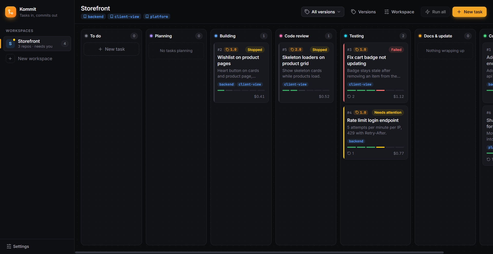
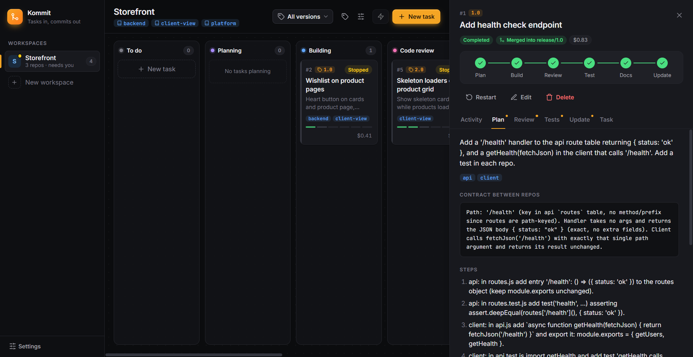
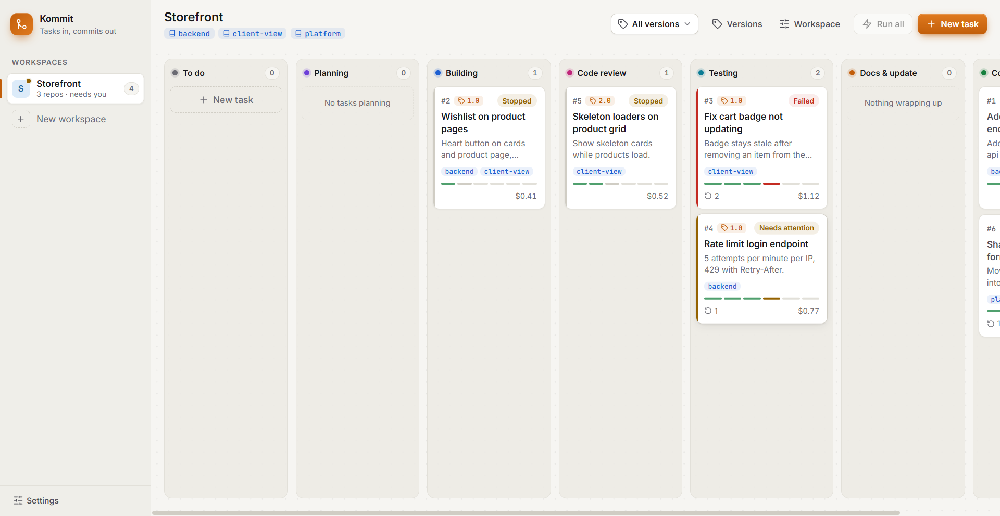
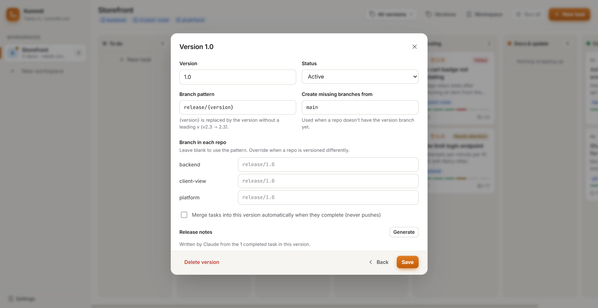

# Kommit

> Tasks in, commits out.

**Kommit** is a desktop task board that hands your development tasks to [Claude Code](https://claude.com/claude-code) running on your own machine. You write a task. Kommit walks it through **plan → build → code review → test → docs → update** across one or more repositories. It only marks the task complete when an independent review approves it and the real test suites pass. The result is a clean commit on a task branch, ready to merge into your release branch.



---

## Table of contents

- [Why Kommit](#why-kommit)
- [Features](#features)
- [Screenshots](#screenshots)
- [How a task flows](#how-a-task-flows)
- [Workspaces: several repos, one task](#workspaces-several-repos-one-task)
- [Versions and release branches](#versions-and-release-branches)
- [Tests are mandatory](#tests-are-mandatory)
- [Requirements](#requirements)
- [Getting started](#getting-started)
- [Using Kommit](#using-kommit)
- [Settings reference](#settings-reference)
- [Safety model](#safety-model)
- [How Claude Code is driven](#how-claude-code-is-driven)
- [Architecture](#architecture)
- [Data and privacy](#data-and-privacy)
- [Development](#development)
- [Costs](#costs)
- [Troubleshooting](#troubleshooting)
- [Limitations and roadmap](#limitations-and-roadmap)
- [License](#license)

---

## Why Kommit

Coding agents are good at writing code, but a real task needs more: a plan, changes that agree across repos, a second pair of eyes, tests that actually run, docs, a status update and a tidy commit on the right branch. Kommit turns that checklist into a pipeline and gives you a board to watch it happen. You stay in control of what gets merged and pushed.

## Features

- **Autonomous pipeline:** every task goes through Plan, Build, Code review, Test, Docs and Update. Failed reviews, failing tests and merge conflicts send the task back to Build with the exact feedback, up to a retry limit you set.
- **Independent code review:** the reviewer is a *fresh* Claude session that sees the real diff, not the developer session's own summary.
- **Real test gate:** Kommit runs each repo's test command itself. Only exit code 0 counts.
- **Tests are always required:** if a repo has no tests, Claude sets up a test setup that fits the stack and writes tests suited to the change (unit, API, security, UI, accessibility).
- **Multi-repo workspaces:** group `client`, `backend` and `platform` repos. One Claude session sees all of them, the planner picks which repos to change, and it defines the contract between them so both sides match.
- **Versions:** each version maps to a release branch per repo (`release/2.3` by default). Task branches start from it, stay in sync with it, and merge back into it with one click or automatically.
- **Release notes:** Claude writes release notes for a version from its completed tasks.
- **Git hygiene:** one isolated git worktree per repo per task, one squashed commit per changed repo, and all-or-nothing merges across repos. Kommit never pushes.
- **Live activity:** stream Claude's tool calls and messages, see the plan, review findings, per-repo test output, the status update and the commit message.
- **Cost tracking** per task, from Claude Code's own usage reports.
- **Light and dark themes:** follows the system, or pick one in Settings. Keyboard accessible, and respects reduced-motion settings.
- **Uses your existing Claude Code login.** No API keys are stored in the app.

## Screenshots

| | |
|---|---|
|  |  |
| **Task detail:** the plan, the repos it touches, and the contract between them | **Board (light):** stage columns with mini progress bars and status |
|  | |
| **Versions:** branch pattern, per-repo branch overrides, auto-merge, release notes | |

## How a task flows

```
 To do ─▶ Plan ─▶ Build ─▶ Code review ─▶ Test ─▶ Docs ─▶ Update ─▶ Completed ─▶ Merge into version
                    ▲            │            │
                    └────────────┴────────────┘
          changes requested · failing tests · missing tests · merge conflicts
                    (back to Build, up to "Max fix attempts")
```

| Stage | Who | What happens |
|---|---|---|
| **Plan** | Claude (read-only) | Explores every repo in scope. Decides which repos must change, defines the **contract** between them (routes, payloads, shared types), lists steps, risks and the tests to write. |
| **Build** | Claude (same session) | Implements the plan and its tests across the affected repos. If a repo has no test setup, it creates one and reports the command. |
| **Code review** | A fresh Claude session (read-only) | Reads the real diff of every repo. Checks correctness, security, test coverage, and that every repo matches the contract. Blocker or major issues send the task back to Build. |
| **Test** | Kommit | Commits a checkpoint, merges the latest base or version branch into the task branch, then runs each changed repo's test command. Conflicts are handed to Claude to resolve. |
| **Docs** | Claude | Updates README, docs, comments or CHANGELOG where the change needs it, and changes nothing otherwise. |
| **Update** | Claude + Kommit | Claude writes a status update and a commit message. Kommit squashes the work into **one commit per changed repo** on the task branch. |
| **Merge** | You, or auto | Merges the task branch into the version branch in every repo, all or nothing. |

Task statuses: **To do**, **Queued**, **Running**, **Completed**, **Failed**, **Stopped** and **Needs attention**. Needs attention means the version branch moved and now conflicts. Press **Update & retest** and Claude resolves the conflict.

## Workspaces: several repos, one task

A **workspace** is a list of repositories, each with a name, a short description ("Vue client", "Express API"), a test command and an optional setup command.

When a task starts, Kommit creates a **task folder** with one git worktree per repo in scope, all on the same branch:

```
<app data>/worktrees/<workspace>/task-12-add-wishlist/
├── client-view/   worktree on kommit/v2.3/task-12-add-wishlist
├── backend/       worktree on kommit/v2.3/task-12-add-wishlist
└── platform/      worktree on kommit/v2.3/task-12-add-wishlist
```

- One Claude session works from the task folder and sees every repo, so an API change and the code that calls it are written together.
- **Auto scope:** the planner decides which repos to change. You can also pick repos in the New task dialog to limit the scope.
- A repo Claude changed even though the plan didn't list it is still tested and committed.
- Repos that were only read get no commit. Their worktree and empty branch are removed.
- Single-repo workspaces work the same way, with Claude working directly inside the repo's worktree.
- Repos that aren't git repositories are supported, but they're edited in place with no branch or commit.

## Versions and release branches

Create versions in **Versions** (top bar). Each version has:

| Field | Default | Meaning |
|---|---|---|
| Name | e.g. `v2.3` | Shown on cards and used in branch names |
| Status | Active | Planned, Active or Released. Released versions are hidden from the New task picker. |
| Branch pattern | `release/{version}` | `{version}` is the name without a leading `v`, so `v2.3` becomes `release/2.3` |
| Per-repo branch | *(pattern)* | Override for repos versioned differently, e.g. `client-release/5.1` |
| Create missing branches from | `main` | If a repo has no version branch, it's created from this (falling back to `origin/<branch>`, then `HEAD`) |
| Auto-merge | off | Merge tasks into the version branch as soon as they complete |

How a versioned task behaves:

1. Task branches are created from the version branch: `kommit/v2.3/task-12-add-wishlist`.
2. Before tests run, the latest version branch is merged into the task branch, so the task is tested together with everything merged before it. Conflicts go back to Claude.
3. On completion, the work is squashed into one commit on top of the version branch.
4. **Merge into release/2.3** checks every repo for conflicts first (`git merge-tree`). Only if all are clean does it merge them all. Merged task branches and worktrees are then cleaned up.
5. **Generate release notes** writes Markdown release notes from the version's completed tasks.

Tasks without a version branch from each repo's current branch and merge back into it.

## Tests are mandatory

A task can't complete without passing tests in every repo it changed.

- **Repo has a test command:** Claude adds or updates tests for the change, and Kommit runs the command.
- **Repo has no test command:** Claude uses the repo's existing test setup if there is one. Otherwise it sets up a lightweight one that fits the stack:

  | Stack | Test setup |
  |---|---|
  | Vite / Vue / React | Vitest + Testing Library |
  | Node APIs | `node:test` or Vitest with supertest |
  | Python | pytest |
  | Multi-page user flows | Playwright, only when the task is that kind of flow |

  Claude reports the command, and Kommit runs it. When the task is merged, that command is saved to the repo's settings for future tasks.
- **No tests at all after Build:** the task goes back to Build ("Tests are missing").
- **Kinds of tests:** Claude is told to write the kinds that fit the work: unit tests, API/backend tests, security tests (bad input, injection attempts, unauthorized access), UI tests, and accessibility and usability checks.
- **Review:** missing or weak tests count as a major issue.
- **Opt-out:** turn on **Skip tests for this repo** (Workspace settings → Advanced) for docs-only or config-only repos.

## Requirements

- **Node.js** 20 or newer, and npm
- **git** 2.38 or newer (uses `git merge-tree --write-tree`)
- **Claude Code CLI**, installed and logged in. Running `claude` in a terminal should work. Kommit uses that login (subscription or API key), and the app stores no keys of its own.
- Developed and tested on **Windows 11**. The code handles macOS and Linux paths and process trees, but those platforms are less tested.

## Getting started

```bash
git clone https://github.com/csjames03/kommit.git
cd kommit
npm install
npm run dev
```

`npm install` downloads Electron's binary (about 100 MB) on first install.

| Script | What it does |
|---|---|
| `npm run dev` | Start the app with hot reload (electron-vite) |
| `npm run build` | Build main, preload and renderer bundles into `out/` |
| `npm start` | Preview the production build |
| `npm test` | Run the pipeline test suite |
| `npm run dist` | Build the Windows installer, `dist/Kommit-Setup-<version>.exe` |
| `npm run dist:dir` | Build an unpacked app folder only (`dist/win-unpacked/Kommit.exe`), with no installer |

### Install as a desktop app (Windows)

```bash
npm run dist
```

Run `dist/Kommit-Setup-0.1.0.exe`. It installs for your user account only, with no admin rights needed, and adds **Kommit** to the desktop and Start menu. Uninstall it from *Settings → Apps*. Your data in `%APPDATA%\Kommit` is kept.

Notes:
- The installer isn't code-signed, so Windows SmartScreen may warn you the first time you run a copy downloaded from elsewhere. Choose *More info → Run anyway*.
- The installed app and `npm run dev` share the same data, and only one can run at a time. Opening Kommit again just focuses the open window.
- The app finds `claude` on your PATH or in `~/.local/bin`. If it's somewhere else, set its path in Settings.
- `mac` (dmg) and `linux` (AppImage) targets are configured, but they must be built on those platforms (`npx electron-builder --mac` or `--linux`) and are untested.

## Using Kommit

1. **Create a workspace.** Click **New workspace**, then **Browse…** to each repository. Give each a name and a short description. Test and setup commands are filled in automatically for Node projects. Leave the test command blank if the repo has no tests, and Claude will create them.
2. **(Optional) Add workspace notes:** stack, conventions, how the repos fit together, things to never touch. They're sent with every stage. Each repo's own `CLAUDE.md` is also used.
3. **(Optional) Create a version** under **Versions**.
4. **Create a task.** Write a clear title and description with acceptance criteria. Pick a version, and leave repos on **Auto** or pick them.
5. **Start it** (or **Run all** to queue every to-do task). Watch the **Activity** tab, and check **Plan**, **Review**, **Tests** and **Update** as they fill in.
6. **Merge.** When the task completes, review the branch if you like, then press **Merge into release/…**. Push the release branch yourself when you're ready.

Task actions: **Start**, **Stop**, **Resume from \<stage\>**, **Update & retest**, **Restart** (discards the task's changes, after asking), **Edit**, **Open folder**, **Clean up** (removes worktrees, keeps branches) and **Delete** (keeps branches).

## Settings reference

**App settings** (sidebar → Settings)

| Setting | Meaning |
|---|---|
| Appearance | System, Light or Dark |
| Claude Code CLI path | Blank uses `claude` from your PATH |
| Tasks running at once | How many tasks run in parallel. Each is its own Claude session. |

**Workspace settings**

| Setting | Meaning |
|---|---|
| Repositories | Folder, name, description and test command for each repo |
| Setup command | Per repo. Runs once in a new worktree before tests (e.g. `npm install`, since worktrees start without `node_modules`). |
| Skip tests for this repo | Per repo. For docs-only or config-only repos. |
| Workspace notes | Context sent to Claude with every stage |
| Max fix attempts | How many times a task may go back to Build before it fails (default 3) |
| Model | Optional `--model` override, e.g. `sonnet` or `opus` |
| Allowed tools | Tools Claude may use while building, e.g. `Read Edit Write Bash(npm *)`. Anything else is denied. |

## Safety model

- **Isolation:** all work happens in per-task git worktrees inside the app's data folder. Your working copies aren't touched. The one exception is merging into a branch you have checked out, and that merge is refused if the working copy has uncommitted changes.
- **No pushes, ever.** Kommit commits and merges locally only.
- **Least privilege:** Claude runs in `dontAsk` permission mode with an explicit allow list. Plan and review stages are read-only. The update stage has no tools. Build tools are configurable per workspace.
- **No git from Claude:** the system prompt forbids Claude from committing, pushing, merging or changing branches. Kommit does all git operations itself.
- **Stop means stop:** the Stop button kills Claude and its whole process tree, including test runners.
- **Confirmations** before discarding work (Restart) or deleting tasks, workspaces and versions.
- **No secrets in the app:** authentication is Claude Code's own login. Kommit stores no API keys.

## How Claude Code is driven

Each stage runs the CLI headless, with the prompt sent on stdin:

```
claude -p --output-format stream-json --verbose \
       --permission-mode dontAsk --allowedTools <stage tools> \
       --json-schema <stage output schema> \
       --append-system-prompt <pipeline rules> [--resume <session>] [--model <model>]
```

- **Streaming:** `stream-json` events become the live activity log.
- **Structured output:** `--json-schema` makes each stage return machine-readable data (plan, review verdict, test commands, commit message), which drives the state machine.
- **Sessions:** Plan, Build, Docs and Update share one session (`--resume`). The reviewer always starts fresh.
- **Costs:** a resumed session reports a running total, so Kommit adds only the difference.

## Architecture

```
┌──────────────────────── Electron ────────────────────────┐
│ Renderer (React)                                          │
│   Sidebar · Board · Task detail · Dialogs                 │
│         ▲ task:updated / task:log events │ IPC calls      │
│         │                                 ▼               │
│ Preload (contextBridge: window.api)                       │
│         │                                                 │
│ Main process (Node)                                       │
│   store.js     JSON store + per-task .jsonl logs          │
│   pipeline.js  queue · stages · retries · merge           │
│   prompts.js   stage prompts + JSON schemas               │
│   claude.js    spawns `claude -p`, parses stream-json     │
│   git.js       worktrees · version branches · sync ·      │
│                squash · merge-tree checks · merges        │
│   proc.js      shell commands + process-tree kill         │
└──────────────────────────┬───────────────────────────────┘
                           │ cwd = task folder
                           ▼
               your repos (git worktrees per task)
```

```
src/
├── main/                 Electron main process
│   ├── index.js          window, IPC handlers, notifications, data carry-over
│   ├── pipeline.js       task state machine, task folders, versions, merge
│   ├── git.js            git operations
│   ├── claude.js         Claude Code CLI runner and log parsing
│   ├── prompts.js        prompts, testing guidance, output schemas
│   ├── proc.js           shell runner, process-tree kill
│   └── store.js          persistence and migration of older data
├── preload/index.js      safe IPC bridge (contextIsolation on, nodeIntegration off)
└── renderer/             React UI (plain CSS design tokens, inline SVG icons,
    └── src/              bundled Inter and JetBrains Mono fonts)
test/pipeline.test.mjs    pipeline tests
docs/screenshots/         README images
```

## Data and privacy

Everything stays on your machine.

| What | Where (Windows) |
|---|---|
| Workspaces, tasks, settings | `%APPDATA%\Kommit\data.json` |
| Activity logs | `%APPDATA%\Kommit\logs\<task>.jsonl` |
| Task worktrees | `%APPDATA%\Kommit\worktrees\` |

Code and prompts reach Anthropic only through Claude Code, exactly as when you use `claude` yourself. If you used the app under its previous name, *Commitment Issues*, your data is copied over automatically on first launch.

## Development

```bash
npm test
```

The test suite runs the **real pipeline against real git repositories** created in a temp folder, with only Claude faked. It covers:

- single-repo and multi-repo flows, and planner scope versus user-picked repos
- version branch creation, per-repo overrides, merging and cleanup
- conflicts with an updated version branch, which get resolved and land on top of it
- merge conflicts after completion (needs attention, then resume, then merge)
- auto-merge
- review rejections, failing tests, missing tests, and repos with tests turned off
- test commands set up by Claude and saved on merge
- restart from scratch
- cost accounting for resumed sessions
- log formatting
- migration of older data

The tests run in parallel and take about 30 seconds on Windows.

Tech stack: Electron, electron-vite, Vite, React 19, plain CSS. There's no UI framework, and runtime dependencies are only React.

## Costs

Every Claude stage is a Claude Code session, billed to whatever account `claude` is logged into. The board shows a running cost per task. As a reference, a small task touching two repos took about 4 minutes and cost about **$0.80** on Sonnet. Set **Model** in Workspace settings to trade speed and quality against cost.

## Troubleshooting

| Problem | Fix |
|---|---|
| "Couldn't find the Claude Code CLI" | Make sure `claude` works in a terminal, or set its full path in Settings. |
| Tests fail with missing modules | Set the repo's **Setup command** (e.g. `npm install`). Worktrees start without `node_modules`. |
| Merge refused: "has uncommitted changes" | You're merging into a branch checked out in your working copy. Commit or stash there first. |
| Task shows **Needs attention** | The version branch changed and conflicts with the task. Press **Update & retest**. |
| "The same folder is added twice" | Each repo in a workspace needs its own folder. |
| Task was interrupted when the app closed | It's marked Stopped. Press **Resume**. |

## Limitations and roadmap

- The Windows installer is unsigned, and there's no auto-update yet. Rebuild and reinstall to update.
- Pushing branches and opening pull requests is intentionally manual for now.
- Possible next steps: PR creation, an integration-test command per workspace, per-stage model selection, code signing and auto-update.

## License

[MIT](LICENSE) © csjames03
